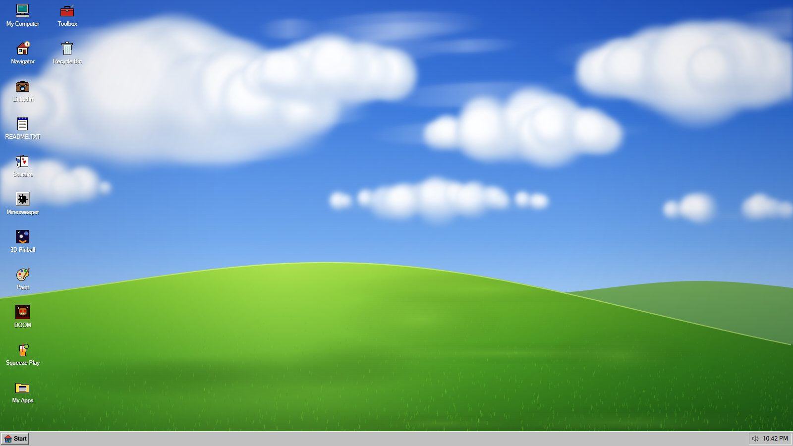
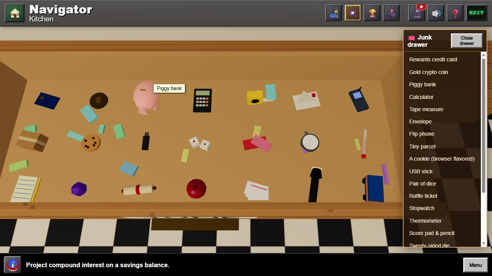
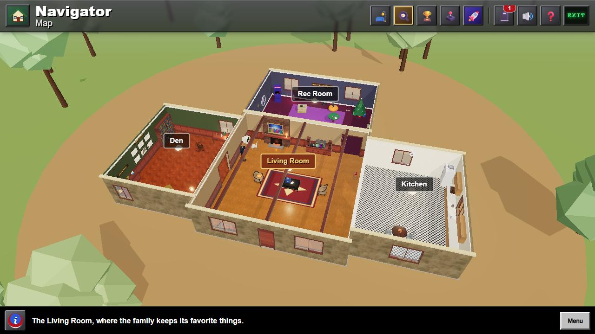

<pre align="center">
       __                _       _                          __    _
  ____/ /___  ____ ___  (_)___  (_)____________  __________/ /_  (_)___
 / __  / __ \/ __ `__ \/ / __ \/ / ___/ ___/ _ \/ ___/ ___/ __ \/ / __ \
/ /_/ / /_/ / / / / / / / / / / / /__/ /__/  __/ /  / /__/ / / / / /_/ /
\__,_/\____/_/ /_/ /_/_/_/ /_/_/\___/\___/\___/_/   \___/_/ /_/_/\____/
                                                              ___  ____
        +------------------------------------------------+   / _ \| ___|
        |  [#] Start |  Navigator  |  Solitaire  | 7:54 PM|  | (_) |___ \
        +------------------------------------------------+   \__, |___) |
                                                               /_/|____/
</pre>

<p align="center">
  <a href="https://dominiccerchio.com"><b>dominiccerchio.com</b></a> ·
  <a href="https://dominiccerchio.com/navigator.html">Navigator (3D)</a> ·
  <a href="https://dominiccerchio.com/terminal.html">classic terminal</a> ·
  <a href="https://www.linkedin.com/in/dcerch/">LinkedIn</a>
</p>

<p align="center">
  
  
  
  
  
  
</p>

---

## 💾 It's 1996 again

My personal site boots straight to a **Windows 95-style desktop**: a big green hill under a cobalt sky (painted in code, in the spirit of the famous XP wallpaper), a Start button and a taskbar. There's no loading screen, and the desktop is up in under half a second.

Double-click around. There's a LinkedIn icon, a `README.TXT`, a Recycle Bin (my old green-screen homepage is in it), and a stack of classic programs, each rebuilt from scratch:

| Icon | Program | What it is |
|---|---|---|
| 🏠 | **Navigator** | A 3D, explorable house of everything I've built. It's an homage to *Packard Bell Navigator*, the house-shaped shell our family PC booted into. See below. |
| 🃏 | **Solitaire** | Klondike with Draw One/Three, standard or Vegas scoring, six original card backs, and *that* bouncing-cards victory. |
| 💣 | **Minesweeper** | Beginner, Intermediate, Expert and Custom. Chording, ? marks, Best Times, and a smiley that gets nervous. |
| 🚀 | **Space Pinball** | An original table in the spirit of *3D Pinball – Space Cadet*: bumpers, a ramp, a black hole, missions, and ranks from Cadet to Fleet Admiral. |
| 🎨 | **Paint** | 16 tools, the 28-color palette, magnifier, select/move, undo, and save as PNG. |
| 👹 | **DOOM** | The real shareware episode, running in WebAssembly. |
| 🧃 | **Squeeze Play** | Cold-press juice recipes for the Nama J2: tick what's in your fridge, see what you can make. |
| 📁 | **My Apps / Toolbox** | My full apps and 21 tiny tools, in Explorer-style folders. |



> **Try:** Start ▸ Run… and type `kidspace`, `winmine`, `pbrush`, `dos` or `help`. Shut Down… works too.

---

## 🏠 Navigator

**Navigator** opens a 3D version of the house from *Packard Bell Navigator 3.5* (Ark Interface, 1995). I researched the original's rooms, toolbar, status bar, InfoGuide and house map from period screenshots, then rebuilt them: cherry wood, honey parquet, big windows onto trees, and a black status bar that tells you what you're hovering over.

Every app I've built is a physical object somewhere in the house:


| Room | Object | Opens |
|---|---|---|
| Living Room | 📺 **CRT television** | About me, on Channel 3 |
| | 🖼️ **Family portrait** above the mantle | A '96 laser-background picture day: Mom and Dad seated, four kids behind, and Simba, Mugsy and Tiger |
| | 🕯️ **Memorial candle** | Remembrance |
| | 🗳️ **Ballot box** | [Ranked Choice Voting](apps/rankedchoicevoting.html) |
| | 💼 **Leather briefcase with an "in" badge** | Career and [LinkedIn](https://www.linkedin.com/in/dcerch/) |
| | 🖥️ **Beige family PC** | The [classic terminal](terminal.html) site |
| | ☎️ **Rotary phone** | A working keypad. Some numbers are… special |
| Kitchen | 🧰 **The junk drawer** | 21 trinkets, one per [Toolbox](toolbox.html) snippet |
| | 🧲 **Fridge magnets** | A new slogan every click |
| | 🧃 **Cold-press juicer** | [Squeeze Play](apps/juicer.html) |
| Den | 📜 **Certificates wall** · 🦺 **"Giving Back" shelf** | Certifications, education and volunteering |
| | 🏛️ **Museum case** | [The Archive](apps/archived.html) |
| | 📚 **Bookshelf** | Mostly books. *Mostly.* |
| Rec Room | 📦 **Cardboard box** · 🛟 **Life ring** · 🎲 **Game table** · 🎄 **Tree** | [Kojima](apps/kojima.html) · [Lost at Sea](apps/lostatsea.html) · [Everybody is John](apps/everybodyisjohn.html) · [Secret Santa](apps/secretsanta.html) |
| | 🕹️ **404 Arcade** | Every way to get lost ([404](404.html)) |
| | 🌌 **A starry round hatch** | → Ark KidSpace |

<details>
<summary>📸 The junk drawer & the house map</summary>

| The junk drawer | Navigator's house map |
|---|---|
|  |  |

</details>

### 🚀 Ark KidSpace

Navigator shipped with **Ark KidSpace**, a kids' room full of clickable gags. Its look was a space station with glowing blue plasma tubes, the Moon and Earth out the window, and a striped metal floor. Inside were a lavender program shelf with a robot head and an alien in a jar, a marble filing cabinet (*Friends, Paintings, Homework, Personal, Misc.*), a console desk with a red surprise box, and a guide who popped up with tips. You could switch the view to Mars, a jungle tree house or the beach.

So I rebuilt it. The shelf launches the desktop games, and every drawer pops open with a little toy of its own: *Friends* is a corkboard of pen-pal postcards you can write back to, *Paintings* is a fridge gallery with a crayon doodle pad, *Homework* is a Space Math worksheet (the dog may eat it), *Personal* is Rivet the robot's padlocked diary, and *Misc.* is a junk drawer of pogs, a slap bracelet and a virtual pet. The jack-in-the-box guide is an original character, and the lever on the desk changes the view.


---

## 🗺️ Floor plan

```
                              N
                              ^
                 +----------------------------+
                 |          REC ROOM          |
                 |  [arcade]  [box]   [tree]  |
             (o)=|  [symbols] [ring]  [table] |      (o) = starry hatch
           KidSpace                   +-door--+          -> Ark KidSpace
  +--------------+-----------+--------+-------+--+-----------------+
  |      DEN     |        LIVING ROOM            |     KITCHEN     |
  | [certs]      | [portrait]  [TV]              |   [fridge]      |
  | [bookshelf] door [case]  [ballot box]      door  [JUNK DRAWER] |
  | [giving back]| [PC]   [phone]   [cat]        |   [table]       |
  | [archive]    |                               |                 |
  +--------------+-------------+-door-+----------+-----------------+
                                front
```

## 🎮 Controls

```
  DESKTOP                                 NAVIGATOR
  double-click / tap   open               drag            look around
  drag title bar       move window        hover           status bar explains it
  corner grip          resize             click           walk up to it & open
  Start > Run...       commands           1 2 3 4 5       rooms (5 = KidSpace)
  Start > Shut Down    ...it's now safe   house icon      Navigator's house map
                                          Menu            everything as a list
                                          EXIT            back to Windows
```

---

## 🕵️ The Curiosity Protocol (ARG)

The site has always hidden a small alternate-reality game. Inside Navigator it became an in-world clue hunt, and your 📓 journal writes itself as you go.

<details>
<summary>⚠️ Full spoilers</summary>

1. **Den → bookshelf → *Leviathan*** (Hobbes, 1651). A word is scratched out of "*____ is the lust of the mind*."
2. Say it to the house: **type `curiosity`** anywhere, or **dial it** on the rotary phone (`2-8-7-4-6-7-4-8-9`).
3. The **TV** switches itself on: *"You decide to click the symbols."*
4. **Rec Room → the symbol plaque**: click until every glyph burns green.
5. A **travelling merchant cat** appears by the fireplace. *"Khajiit has wares, if you have coin."* 💰
</details>

---

## 🧱 How it's built

It's static files on GitHub Pages: no framework and no bundler. The desktop is plain HTML/CSS/JS and loads no 3D engine at all. Navigator loads [three.js](https://threejs.org) r170 from a CDN through an import map, and the games are single self-contained HTML files.

**Making the 3D look good:**
- **Lighting:** each room is photographed into its own reflection probe once it's furnished, so glossy wood and chrome reflect the actual room. Ground-truth ambient occlusion (GTAO), a soft shadow-casting ceiling lamp in the room you're in, MSAA, ACES tone mapping and a gentle bloom. An adaptive governor sheds the expensive extras on slower machines.
- **Outdoors:** a real CC0 photo panorama (Poly Haven *Noon Grass*) projected onto a grounded skybox, so every window looks out on a lawn and tree line.
- **Materials:** varnished clear-coat cherry wood, plus PBR floors, walls and brick from **Poly Haven (CC0)**.
- **Furniture:** about 60 real CC0 models (sofa, armchairs, a vintage CRT, a grandfather clock, an electric stove, a leather reading chair, a stock pot and carpentry tools…). Each room streams in on its own, with a procedural stand-in shown until its model arrives.
- **Hand-built where no model exists:** shaker kitchen cabinets with marble counters and subway tile, a rounded retro fridge, a contoured arcade cabinet, a needle-textured Christmas tree, a lathe-turned hard hat and bean bag, and soft-furred cats with tabby stripes.
- **Trim:** cherry wainscoting, baseboards and crown molding.

**Procedural where it counts:** the wallpaper, family portrait, certificates, TV and PC screens, KidSpace views, plasma tubes and every sound effect are generated in code.

```
.
|-- index.html                <- the Windows 95-style desktop (fast, no 3D)
|-- navigator.html            <- Navigator: the 3D house
|-- css/  win95.css · navigator.css
|-- js/
|   |-- desktop/              <- desktop shell: desktop.js, icons.js, wallpaper.js
|   |-- data.js               <- ALL CONTENT LIVES HERE (edit me!)
|   |-- main.js               <- Navigator engine: camera, picking, travel, map, drawer
|   |-- world.js              <- the house shell + interactive props
|   |-- furnish.js            <- places the CC0 furniture models
|   |-- kidspace.js           <- Ark KidSpace
|   |-- assets.js             <- glTF/PBR loading helpers
|   `-- textures.js · screens.js · arg.js · audio.js · ui.js
|-- apps/
|   |-- win95/                <- solitaire, minesweeper, pinball, paint (one file each)
|   |-- doom/                 <- DOOM wrapper + doom.wasm (see NOTICE.txt)
|   |-- kidspace-drawers.html <- the five KidSpace drawer toys
|   `-- *.html                <- my full apps (incl. juicer.html = Squeeze Play)
|-- assets/models · textures · hdri  <- CC0 Poly Haven assets (see assets/CREDITS.txt)
|-- tools/fetch_assets.py     <- re-download / shrink the 3D assets
|-- terminal.html             <- the previous green-screen site, preserved
`-- toolbox.html · apps.html · 404.html
```

### ✏️ Adding stuff
* **Certification, volunteer gig or job:** edit `js/data.js`. The Den, LinkedIn window and README.TXT update themselves.
* **Toolbox snippet:** register it in `toolbox.html`, then add a trinket to `TRINKETS` in `js/data.js`. It appears in the junk drawer *and* the Toolbox folder.
* **Desktop program:** add an entry to `P` in `js/desktop/desktop.js` (an iframe `url` or a built-in `view`) and, optionally, to `DESKTOP` or the Start menu.
* **3D furniture:** add a Poly Haven id to `tools/fetch_assets.py`, run it, then `put(...)` it in `js/furnish.js`.

### 🏃 Run it locally
```bash
python -m http.server 8000      # then open http://localhost:8000
```

---

## 🙏 Credits & licenses

* **Inspiration:** *Packard Bell Navigator* and *Ark KidSpace* (Ark Interface / Packard Bell, 1994–96). Fan-made homage, not affiliated. No original assets are used.
* **Windows** is a trademark of Microsoft; this desktop is a lookalike with original artwork, no Microsoft files, and a wallpaper painted in code (it is not the *Bliss* photograph).
* **DOOM:** engine [jacobenget/doom.wasm](https://github.com/jacobenget/doom.wasm) (**GPL-2.0**). Game data is the freely distributable DOOM shareware WAD, © id Software. See [`apps/doom/NOTICE.txt`](apps/doom/NOTICE.txt).
* **3D models & textures:** [Poly Haven](https://polyhaven.com), **CC0**. See [`assets/CREDITS.txt`](assets/CREDITS.txt).
* **Solitaire, Minesweeper, Space Pinball and Paint** are original recreations written for this site, with credit to the original creators in each About box.
* **Other credits:** the *Leviathan* excerpt is Hobbes (1651, public domain). "Khajiit has wares" nods to *Skyrim*. Built with [three.js](https://threejs.org).

<pre align="center">
   /\_/\        /\_/\        /\_/\
  ( o.o )      ( -.- )      ( ^.^ )   < it's now safe to turn off
   > ^ <        > ^ <        > ^ <      your computer.
</pre>
