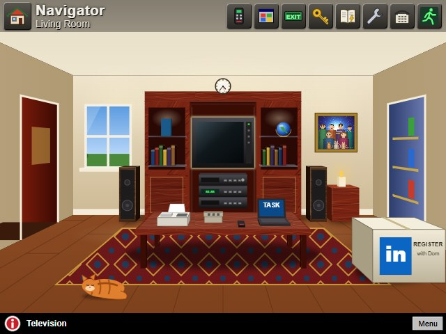
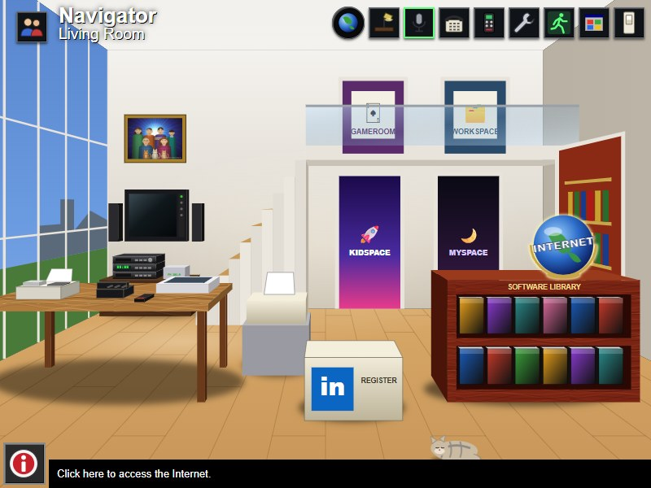
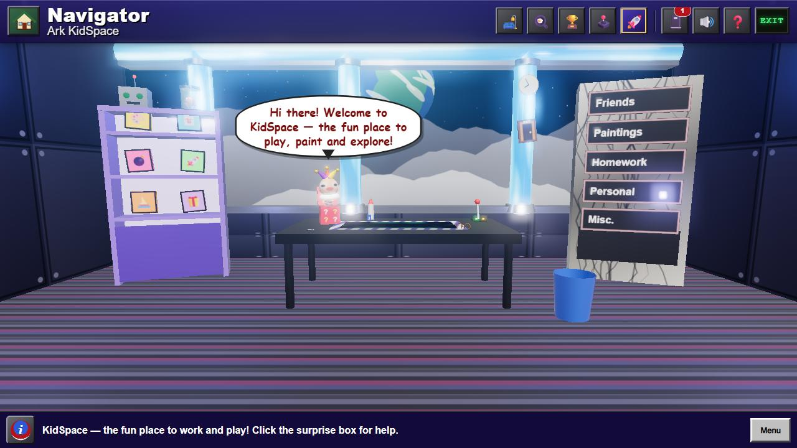

<pre align="center">
       __                _       _                          __    _
  ____/ /___  ____ ___  (_)___  (_)____________  __________/ /_  (_)___
 / __  / __ \/ __ `__ \/ / __ \/ / ___/ ___/ _ \/ ___/ ___/ __ \/ / __ \
/ /_/ / /_/ / / / / / / / / / / / /__/ /__/  __/ /  / /__/ / / / / /_/ /
\__,_/\____/_/ /_/ /_/_/_/ /_/_/\___/\___/\___/_/   \___/_/ /_/_/\____/
                                                              ___  ____
        +------------------------------------------------+   / _ \| ___|
        |  [#] Start |  Navigator  |  Solitaire  | 7:54 PM|  | (_) |___ \
        +------------------------------------------------+   \__, |___) |
                                                               /_/|____/
</pre>

<p align="center">
  <a href="https://dominiccerchio.com"><b>dominiccerchio.com</b></a> ·
  <a href="https://dominiccerchio.com/navigator.html?v=3.5">Navigator 3.5</a> ·
  <a href="https://dominiccerchio.com/navigator.html?v=3.9">Navigator 3.9</a> ·
  <a href="https://dominiccerchio.com/terminal.html">classic terminal</a> ·
  <a href="https://www.linkedin.com/in/dcerch/">LinkedIn</a>
</p>

<p align="center">
  
  
  
  
  
</p>

---

## 💾 dom 95

My personal site boots straight to **dom 95**, a Windows 95-style desktop with a Start button, a taskbar, and a note on the desktop called `ABOUT.TXT` explaining why it exists.

Double-click around. Drag icons wherever you like or rubber-band a few at once, and right-click the desktop for **Properties**. The Welcome screen has quick links to About Me and LinkedIn. The programs are all rebuilt from scratch:

| Icon | Program | What it is |
|---|---|---|
| 🏠 | **Navigator 3.5** · **Navigator 3.9** | Two 2D homages to *Packard Bell Navigator*, the house-shaped shell our family PC booted into. See below. |
| 🌐 | **Internet Explorer** | Browses the 1990s web through the Internet Archive's Wayback Machine. Favorites go from Yahoo! (1996) to YouTube (2005), and a year picker sends any address you type back in time. A dial-up dialog connects you first. |
| 📞 | **dom Online** | A parody of 90s online services: sign on, hear the 28.8k modem handshake (synthesised live), then the Welcome screen, Buddy List, keywords and a Lobby chat room full of 1996. |
| 📬 | **Inbox** | An Outlook Express-style mailbox with letters from me (and Aunt Linda's chain letter). Compose copies your note and opens my LinkedIn so you can send it there. |
| 🃏 | **Solitaire · FreeCell · Hearts** | Klondike with Vegas scoring and the bouncing-cards win; FreeCell with the real Microsoft deal numbers; Hearts with passing, shooting the moon and a score sheet. |
| ⛷️ | **SkiDom** | Ski downhill, dodge trees, hit the ramps. Keep going past 2,000 m. Something's out there. |
| 🧮 | **Calculator · WordPad** | Standard and Scientific calculator; a WordPad with fonts, formatting and a ruler. |
| 💣 | **Minesweeper** | Beginner, Intermediate, Expert and Custom. Chording, ? marks, Best Times, and a smiley that gets nervous. |
| 🚀 | **Space Pinball** | An original table in the spirit of *3D Pinball – Space Cadet*. |
| 🎨 | **Paint** | 16 tools, the 28-color palette, magnifier, select/move, undo, and save as PNG. |
| 👹 | **DOOM** | The real shareware episode, running in WebAssembly. |
| 👦 | **Commander Keen 4** | Apogee's shareware episode, *Secret of the Oracle*, running in DOSBox (js-dos) from this repo. |
| 🕹️ | **The arcade cabinets** | Arkanoid, *The Elder Scrolls: Arena* and *Daggerfall* (Internet Archive emulation), *Robot Rage* (itch.io embed) and *Victor Vector & Yondo* (yag.im), each behind an insert-coin title card in the Games folder. |
| 🚓 | **On the Run → Getaway** | Miniclip's *On the Run* can't be played anywhere now, so **Getaway** is an original pseudo-3D getaway driver in its honour: checkpoints, traffic and the cops on your tail. |
| 🧃 | **Squeeze Play** | Cold-press juice recipes for the Nama J2. |
| 📁 | **My Apps / Toolbox** | My full apps, and 21 tiny tools restyled as proper Win95 dialogs. |
| 🗑️ | **Recycle Bin** | My old green-screen homepage, plus an **Archived** folder with a `.TXT` note for every app I've retired. |

**Display Properties** has 35 wallpapers and 13 desktop patterns, grouped by era (3.1, 95, 98, 2000 and XP), seven screen savers (Flying Through Space, Flying Houses, Mystify Your Mind, Pipes, Curves and Colors, Scrolling Marquee, Blank Screen) and 19 colour schemes from Windows Standard to Hot Dog Stand. Every one is drawn in code; none are Microsoft images.


> **Try:** Start ▸ Run… and type `kidspace`, `nav39`, `iexplore`, `aol`, `calc`, `winmine`, `pbrush`, `dos` or `help`. Shut Down… works too: the tube collapses to a white line like an old CRT, and the monitor's power button brings it back.

---

## 🏠 Navigator 3.5 and 3.9

Before rebuilding Navigator I read the original install discs on archive.org (`NAV.INI` and the string database), the Passion-PB fan archive, Wikipedia and period screenshots. Both versions follow the original's structure:

- **Hover** anything and the black **caption bar** says what it is. **Click** to use it. Programs open as real windows on the dom 95 desktop.
- The red **InfoGuide** “i” in the bottom-left corner turns on help mode: click anything to hear (yes, spoken aloud) what it does. In 3.9 you can also right-click.
- The **toolbar** runs along the top: Map, Media Controller (the stereo really plays original tunes), Windows, Exit, Security, Manuals, Preferences, Call Center and the **Running Man**, which lists your open desktop windows.
- **Task Jumper**, **Smart Tip** envelopes (3.5), a **Using Your Mouse** tutorial, an **Overview** slideshow, and the numbered **Welcome** screens.

| | Navigator 3.5 (1995 · 640×480) | Navigator 3.9 (1997 · 800×600) |
|---|---|---|
| Look | Warm cherry wood, a house-icon Map button, a translucent toolbar, and a Menu button | A bright two-storey loft, framed toolbar tiles, and khaki dialogs |
| Rooms | Living Room · Info Room · Software Room · Map · Electronic Documents · KidSpace | Living Room (the hub) · Info Room · Software Library · Manuals · WorkSpace · MySpace (with My Crypt and My Lab) · GameRoom · KidSpace |




Where my things live:

| Object | Opens |
|---|---|
| 📺 TV | About me, on Channel 3 |
| 📦 The registration box | LinkedIn ("register with Dom") |
| 💿 The Software Room / Library shelves | Every app and tool, boxed by category. The trash can holds the retired ones |
| 📚 The Manuals | Certifications, volunteering, career… and a well-thumbed copy of *Leviathan* |
| 🖼️ Family portrait · 🕯️ candle | Picture day '96 · remembrance |
| ☎️ Phone · 📠 fax | A working keypad · the mail composer |
| 💼 WorkSpace briefcases (3.9) | One per job |

### 🚀 Ark KidSpace

KidSpace comes in two rooms, **Space** and **Treehouse**, each with two views (Moon base/Mars, Jungle/Beach). It has a bookcase of programs (click one, or drag it onto the desk), five dresser drawers (*Friends, Paintings, Homework, Personal, Misc.*), a striped help box, a magnifying glass that shows names, levers, a skull and a jar that make noises, and things flying past the window. The guide, Pip, is an original character.



---

## 🕵️ The Curiosity Protocol (ARG)

The site has always hidden a small alternate-reality game, and it works in both Navigators. Your 📓 journal (Menu or Task Jumper) writes itself as you go.

<details>
<summary>⚠️ Full spoilers</summary>

1. **Manuals → Additional Information → *Leviathan*** (Hobbes, 1651). A word is scratched out of "*____ is the lust of the mind*."
2. Say it to the house: **type `curiosity`** anywhere, **dial it** on the phone (`2-8-7-4-6-7-4-8-9`), or use it as the Security password.
3. The **TV** switches itself on: *"You decide to click the symbols."*
4. **The symbol plaque** (3.5: the Info Room hallway · 3.9: the MySpace mantel): click it ten times.
5. A **travelling merchant cat** appears in the Living Room. *"Khajiit has wares, if you have coin."* 💰
</details>

---

## 🧱 How it's built

It's static files on GitHub Pages, with no framework, no bundler and no 3D engine in the browser. Like the 1995 original, Navigator's main rooms are **pre-rendered**: each one is modelled in Blender (`tools/nav3d/rooms/*.py`), rendered once with Cycles, and dithered down to a 256-colour 640×480 or 800×600 PNG (`img/nav/`). The render script also exports every clickable object as a screen-space polygon, plus anchor quads for live overlays (clock hands, shelf labels, the family portrait, the boat in the porthole) into `js/nav2d/renders.js`. In the page, `js/nav2d/rendered.js` stacks invisible hotspots over the still image. The Map, Manuals and KidSpace are still SVG.

To rebuild a room (Blender 4.x and Pillow):

```bash
cd tools/nav3d
python tex.py && python tex_extra.py                  # procedural textures -> tex/
blender -b --factory-startup -P rooms/v39_gameroom.py  # add -- --fast for a quick preview
python post.py v39_gameroom                           # -> img/nav/*.png + js/nav2d/renders.js
```

```
.
|-- index.html                <- the dom 95 desktop
|-- navigator.html            <- Navigator (?v=3.5 or ?v=3.9)
|-- css/  win95.css · nav2d.css
|-- js/
|   |-- data.js               <- ALL CONTENT LIVES HERE (edit me!)
|   |-- desktop/              <- desktop.js, icons.js, wallpapers.js (+ wallpaper.js hills)
|   |-- nav2d/                <- main.js (engine) · v35.js · v39.js · kidspace.js · manuals.js
|   |                            catalog.js (boxed software) · art.js · icons.js · music.js · portrait.js
|   |                            rendered.js + renders.js (pre-rendered rooms)
|   `-- arg.js · audio.js · ui.js (shared panels)
|-- img/nav/                  <- pre-rendered Navigator rooms
|-- tools/nav3d/              <- Blender scenes that render them
|-- apps/                     <- win95 games, DOOM, and my full apps
|   |-- keen4/ · dos/          <- Commander Keen 4 shareware + js-dos (DOSBox)
|   `-- games/                <- arcade.html (title cards + official embeds), getaway.html
|-- terminal.html             <- the previous green-screen site, preserved
`-- toolbox.html · apps.html · 404.html
```

### ✏️ Adding stuff
* **Certification, volunteer gig or job:** edit `js/data.js`. The manuals, WorkSpace, LinkedIn window and ABOUT.TXT update themselves.
* **A new app:** add it to `APPS` in `js/data.js` and to `SOFTWARE` in `js/nav2d/catalog.js` with a category for each version. It appears on the shelves.
* **Retiring an app:** move it to `ARCHIVE` in `js/data.js`. It becomes a `.TXT` note in Recycle Bin ▸ Archived and goes in the Software Room trash.
* **Toolbox snippet:** register it in `toolbox.html`, then add it to `TRINKETS` in `js/data.js` and to `catalog.js`.
* **A wallpaper:** add a painter to `TILES` or `SCENES` in `js/desktop/wallpapers.js` and an entry to `WALLPAPERS`.

### 🏃 Run it locally
```bash
python -m http.server 8000      # then open http://localhost:8000
```

---

## 🙏 Credits & licenses

* **Inspiration:** *Packard Bell Navigator* and *Ark KidSpace* (Ark Interface / Packard Bell, 1994–97). This is a fan-made homage and isn't affiliated with either. No original assets, sounds or narration are used: every room is an original Blender scene or original SVG.
* **Windows** is a trademark of Microsoft. This desktop is a lookalike with original artwork and no Microsoft files. The wallpapers are painted in code "in the spirit of" each era.
* **DOOM:** engine [jacobenget/doom.wasm](https://github.com/jacobenget/doom.wasm) (**GPL-2.0**). The game data is the freely distributable DOOM shareware WAD, © id Software. See [`apps/doom/NOTICE.txt`](apps/doom/NOTICE.txt).
* **Commander Keen 4:** the unaltered Apogee shareware package (© 1991 id Software), freely distributable under its included LICENSE.DOC, run by [js-dos 6.22](https://github.com/caiiiycuk/js-dos) (**GPL-2.0**, DOSBox). See [`apps/keen4/NOTICE.txt`](apps/keen4/NOTICE.txt) and [`apps/dos/NOTICE.txt`](apps/dos/NOTICE.txt).
* **Arcade cabinets:** no game files from Arkanoid (Taito), *Arena* / *Daggerfall* (Bethesda), *Robot Rage* (KonsomeJona) or *Victor Vector & Yondo* (Sanctuary Woods) are in this repo. They load from the Internet Archive, itch.io and yag.im. **Getaway** is original code and art, a tribute to *On the Run* (Officine Pixel / Miniclip).
* **Solitaire, Minesweeper, Space Pinball and Paint** are original recreations written for this site.
* **Other credits:** the *Leviathan* excerpt is Hobbes (1651, public domain). "Khajiit has wares" nods to *Skyrim*.
<pre align="center">
   /\_/\        /\_/\        /\_/\
  ( o.o )      ( -.- )      ( ^.^ )   < it's now safe to turn off
   > ^ <        > ^ <        > ^ <      your computer.
</pre>
