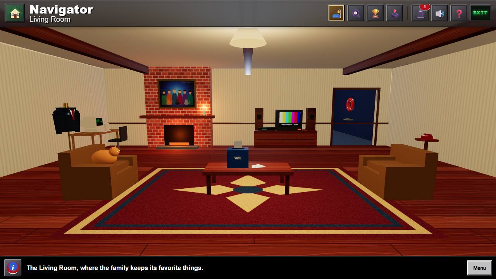

<pre align="center">
       __                _       _                          __    _
  ____/ /___  ____ ___  (_)___  (_)____________  __________/ /_  (_)___
 / __  / __ \/ __ `__ \/ / __ \/ / ___/ ___/ _ \/ ___/ ___/ __ \/ / __ \
/ /_/ / /_/ / / / / / / / / / / / /__/ /__/  __/ /  / /__/ / / / / /_/ /
\__,_/\____/_/ /_/ /_/_/_/ /_/_/\___/\___/\___/_/   \___/_/ /_/_/\____/

        +================================================+
        |   N A V I G A T O R    .    Version 3.5        |
        |   Home Edition         .    est. 1996-ish      |
        +================================================+
</pre>

<p align="center">
  <a href="https://dominiccerchio.com"><b>dominiccerchio.com</b></a> ·
  <a href="https://dominiccerchio.com/terminal.html">classic terminal</a> ·
  <a href="https://www.linkedin.com/in/dcerch/">LinkedIn</a>
</p>

<p align="center">
  
  
  
  
  
</p>

---

## 🏠 Welcome home

My personal site is a **3D house you can walk around in**.

Growing up, our family PC booted into **Packard Bell Navigator**, a mid-’90s "shell" that replaced the Windows desktop with a pre-rendered house. You clicked the TV, the phone, or the bookshelf to launch things. It was cheesy and wonderful, and it's the reason a lot of kids my age thought computers were *places*.

This site takes that idea literally. The flat, painted rooms are now real 3D rooms. Everything I've built lives somewhere in the house as a physical object:

* the voting app is a **ballot box** on the coffee table
* my LinkedIn is an **interview suit** with a little `in` lapel pin
* my pile of tiny web tools is literally a **junk drawer**



<details>
<summary>📸 More screenshots</summary>

| The junk drawer | The house map |
|---|---|
|  |  |

</details>

---

## 🗺️ Floor plan

```
                                N
                                ^
                 +----------------------------+
                 |          REC ROOM          |
                 |  [arcade]  [box]   [tree]  |
                 |  [symbols] [ring]  [table] |
                 |                     +-door-+
  +--------------+-----------+---------+------+--+-----------------+
  |      DEN     |        LIVING ROOM            |     KITCHEN     |
  | [certs]      | [portrait]  [TV]              |   [fridge]      |
  | [bookshelf] door [suit]  [ballot box]      door  [JUNK DRAWER] |
  | [giving back]| [PC]   [phone]   [cat]        |   [table]       |
  | [archive]    |                               |                 |
  +--------------+-------------+-door-+----------+-----------------+
                                front
                          (you start here)
```

### What's in the house

| Room | Object | Opens |
|---|---|---|
| Living Room | 📺 **CRT television** | About me, Channel 3 |
| | 🖼️ **Family portrait** above the mantle | A 1996 laser-background "picture day" portrait: Dad, Mom, big sister, two big brothers, me, and three cats |
| | 🕯️ **Memorial candle** | Remembrance |
| | 🗳️ **Ballot box** | [Ranked Choice Voting](apps/rankedchoicevoting.html) |
| | 👔 **Interview suit with LinkedIn pin** | Career timeline and [LinkedIn](https://www.linkedin.com/in/dcerch/) |
| | 🖥️ **Beige family PC** | The [classic green-screen terminal](terminal.html) version of this site |
| | ☎️ **Rotary phone** | A working keypad. Some numbers are… special |
| Kitchen | 🧰 **The junk drawer** | 21 trinkets, one for each [Toolbox](toolbox.html) snippet (piggy bank, d20, flip phone, cookie, …) |
| | 🧲 **Fridge magnets** | A new slogan every click |
| Den | 📜 **Certificates wall** | Certifications & education |
| | 🦺 **"Giving Back" shelf** | Volunteering: hard hat, soup ladle, hackathon trophy, mentoring mug |
| | 🏛️ **Museum case** | [The Archive](apps/archived.html): retired apps, preserved |
| | 📚 **Bookshelf** | Mostly books. *Mostly.* |
| Rec Room | 📦 **A suspicious cardboard box** | [Kojima Name Generator](apps/kojima.html) `!` |
| | 🛟 **Life ring + message in a bottle** | [Lost at Sea](apps/lostatsea.html) |
| | 🎲 **Game-night table** | [Everybody is John](apps/everybodyisjohn.html) |
| | 🎄 **Tree & presents** | [Secret Santa](apps/secretsanta.html) |
| | 🕹️ **404 Arcade cabinet** | Every way to get lost on this site ([404](404.html)) |
| | ⚑ **A plaque of strange symbols** | 👀 |

---

## 🎮 Controls

```
  +--------------+----------------------------------------------+
  | drag         | look around (or arrow keys)                  |
  | scroll/pinch | zoom                                         |
  | hover        | the status bar tells you what something is   |
  | click        | walk up to it and open it                    |
  | doorways     | light up on hover - click to walk through    |
  | 1 2 3 4      | Living Room . Kitchen . Den . Rec Room       |
  | house icon   | Navigator-style map of the whole house       |
  | journal      | for... curious things                        |
  | Menu         | every object as a plain list (great on       |
  |              | phones and with screen readers)              |
  | EXIT         | bail out to the classic terminal site        |
  | esc          | close / step back                            |
  +--------------+----------------------------------------------+
```

---

## 🕵️ The Curiosity Protocol (ARG)

This site has always had a little alternate-reality game hidden in it. In the house it's become an in-world clue hunt.

> *Something about this house feels… curious.*

Your **📓 journal** writes itself as you find things, and progress is saved in your browser.

<details>
<summary>⚠️ Full spoilers</summary>

1. **Den → bookshelf → *Leviathan*** (Hobbes, 1651). One word has been scratched out of the line "*____ is the lust of the mind*."
2. Say it to the house. Either **type `curiosity`** anywhere, or **dial it** on the rotary phone (`2-8-7-4-6-7-4-8-9`).
3. The **TV** switches itself on: *"You decide to click the symbols."*
4. **Rec Room → the symbol plaque.** Click it ten times until every glyph burns green.
5. A **travelling merchant cat** appears by the fireplace. *"Khajiit has wares, if you have coin."* 💰

Reset everything from the journal once you've finished.
</details>

---

## 🧱 How it's built

There are no frameworks and no bundler: static files served by GitHub Pages. [three.js](https://threejs.org) loads from a CDN through an import map.

**Everything is procedural.** All furniture is built from primitives in code. Every texture is painted on a `<canvas>` at runtime, including the cherry wood, the rug, the certificates and the family portrait. Every sound is synthesized with WebAudio. **The 3D world ships with zero image, model or audio files.**

```
.
|-- index.html            <- Navigator: boot screen, chrome, 3D canvas
|-- css/navigator.css     <- top bar, status bar, Win95 windows
|-- js/
|   |-- data.js           <- ALL CONTENT LIVES HERE (edit me!)
|   |-- main.js           <- engine: camera, picking, travel, map, drawer
|   |-- world.js          <- the house + every prop
|   |-- textures.js       <- procedural canvas textures (wood, rug, portrait...)
|   |-- screens.js        <- animated TV / PC / fridge / arcade / plaque
|   |-- arg.js            <- the Curiosity Protocol
|   |-- audio.js          <- WebAudio sound effects & startup jingle
|   `-- ui.js             <- windows and panel content
|-- terminal.html         <- the previous green-screen site, preserved
|-- toolbox.html          <- the junk drawer's contents (supports ?embed=1#id)
|-- apps.html             <- list view of the full apps
|-- apps/*.html           <- standalone apps
|-- 404.html              <- 16 themed ways to be lost
`-- docs/img/             <- README screenshots only
```

### ✏️ Adding stuff

* **New certification or volunteer gig:** add a line to `CERTIFICATIONS` or `VOLUNTEERING` in `js/data.js`. A new frame or prop appears in the Den.
* **New toolbox snippet:** register it in `toolbox.html`, then add a trinket to `TRINKETS` in `js/data.js` with a `shape`. The drawer lays itself out.
* **New full app:** drop it in `apps/`, add it to `APPS` in `js/data.js`, and give it a physical object in `js/world.js` with `hot(obj, { … action: { type: "app", app: "yourapp" } })`.

### 🏃 Run it locally

ES modules need a server, not `file://`:

```bash
python -m http.server 8000
# -> http://localhost:8000
```

---

## ♿ Accessibility

* The **Menu** button lists every object in every room as plain buttons, so you never have to aim at a 3D object.
* All chrome is keyboard reachable. Rooms are on `1–4`, and `esc` backs out.
* `prefers-reduced-motion` skips the camera flights and the intro.
* No WebGL? You get a plain directory of links instead.
* The mute toggle remembers your choice.

---

## 🙏 Credits

* Inspired by **Packard Bell Navigator 3.5** (Ark Interface / Packard Bell, 1995). This is a fan-made homage and is not affiliated with Packard Bell. No original assets are used.
* The *Leviathan* excerpt is Thomas Hobbes, 1651 (public domain).
* "Khajiit has wares" is a nod to *The Elder Scrolls V: Skyrim*.
* Built with [three.js](https://threejs.org).

<pre align="center">
   /\_/\        /\_/\        /\_/\
  ( o.o )      ( -.- )      ( ^.^ )   < thanks for visiting.
   > ^ <        > ^ <        > ^ <      mind the junk drawer.
</pre>
